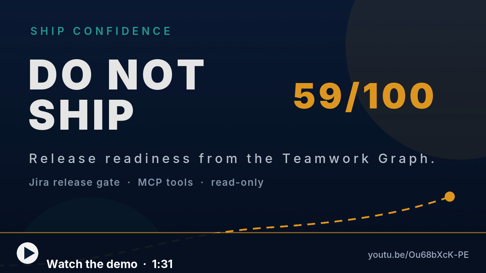

# Ship Confidence

Release-readiness tools for Jira, exposed to AI clients through the Atlassian MCP
server. Ask "is 2.4.0 safe to ship?" in Rovo chat, Claude, or any MCP client and
get a verdict, the reasons, and the gaps in what could be read.

The same logic also renders as a **Jira project page**, so a release manager can see
the verdict without an AI client. One domain layer, two surfaces.

[](https://youtu.be/Ou68bXcK-PE)

A narrated 91-second walkthrough: the verdict, the blocker behind it, and the same
answer arriving in a chat client. **[Watch on YouTube](https://youtu.be/Ou68bXcK-PE)**

Six read-only tools over the Teamwork Graph:

| Tool | Answers |
| --- | --- |
| `get-release-readiness` | verdict, 0–100 score, risk factors, coverage |
| `list-open-blockers` | what is in the way, with owner and link |
| `get-release-risk-factors` | everything ranked, including non-blocking warnings |
| `explain-blocker` | one blocker in depth, with its pull requests and deployments |
| `draft-release-notes` | markdown notes from completed work items |
| `compare-releases` | why one version scores worse than another, factor by factor |

## Run the checks

```bash
npm install
npm run verify        # tsc --noEmit + vitest
```

## Deploy

Requires a Jira Cloud site — a **free developer site is enough** — and Node 22+. No Rovo
licence is needed for external MCP clients; see `SETUP.md` for the full walkthrough.

```bash
npm i -g @forge/cli@latest
forge login
forge register        # replaces the placeholder app.id in manifest.yml
forge deploy
forge install         # choose Jira, then enter <your-site>.atlassian.net
```

`forge deploy` must run before `forge install`.

After install the app appears as **Ship Confidence** in the Jira project sidebar,
on the project it was installed for. It lists that project's versions and scores
the next unreleased one by default.

## **Enable the tools, or nobody will see them**

**External MCP access is off by default.** Until a site admin turns it on, the app
installs, deploys, and is completely invisible to every AI client — with no error
message anywhere.

**Atlassian Administration → Apps → Sites → &lt;your site&gt; → Connected apps →
Ship Confidence → Tools → turn on the tools you want to expose.**

The endpoint clients connect to is:

```
https://mcp.atlassian.com/forge/<appId>
```

`<appId>` is the UUID part of `app.id` in `manifest.yml`.

### Connecting a client

```bash
claude mcp add --transport http ship-confidence https://mcp.atlassian.com/forge/<appId>
```

Then run `/mcp` in the session and complete the OAuth consent screen. Rovo Studio
agents can add the same tools under **Add tools → Connected apps**. `SETUP.md` has the
Inspector and VS Code equivalents, plus troubleshooting.

## Known platform behaviour

- **A missing scope does not raise an error.** The Teamwork Graph returns empty
  results instead. This app probes access when work items come back empty and
  reports `not_permitted` rather than pretending the release is clean.
- **Connecting both Jira and Confluence can disable the endpoint** with
  "…is not allowed to expose its tools over the external MCP endpoint on this
  site". Disconnect Confluence, then toggle the tools off and on.
- **Tool calls have a 55-second budget**; each graph query is capped at 12 seconds
  here.
- **`first` is capped at 25** by the curated query layer. This build asks for 25.
- **The project page resolver runs under the 25 s function budget** (not 55 s), so
  its four graph queries run concurrently.

## Layout

```
src/actions/    thin Forge entry points, one per tool
src/tools/      payload parsing, result envelope, shared pipeline, page report
src/domain/     pure scoring and comparison logic, no SDK imports
src/graph/      Teamwork Graph queries, client port, loader, coverage, probe, versions
src/resolvers/  project-page resolver (versions + one score)
src/frontend/   UI Kit page and its pure view model
skills/         SKILL.md an agent can load to use the tools well
```

## License

GNU Affero General Public License v3.0 — see `LICENSE`. You can run, modify and
redistribute this freely; if you run a modified version as a network service, you
must offer its source to those users too.

## Verify before believing

The curated GraphQL documents in `src/graph/queries.ts` are written from the
curated query list and **must be checked in the Query Builder**
(`https://teamwork-graph.atlassian.com/query-builder`) against a real site before
deploy. Argument shapes there are more likely to be wrong than the TypeScript.
